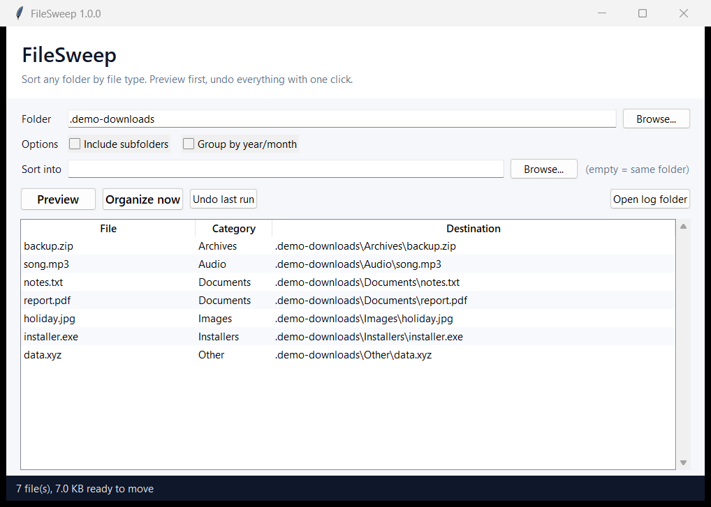

# FileSweep

**Tidy any Windows folder by file type — preview first, undo with one command.**

Day 1 of **30 Windows tools in 30 days** · 100% open source (MIT)



---

## The problem

Your `Downloads` folder becomes a junk drawer: installers mixed with invoices, screenshots
next to ZIP files, nothing findable. Cloud "cleanup" tools want an account, a subscription,
and your files. FileSweep is a single Python script with a GUI: it shows you exactly what it
will move, moves nothing until you press the button, and can undo an entire run in one click.

## Features

- **Preview first.** See every planned move before anything touches disk.
- **One-click undo.** Every run writes a journal; `filesweep undo` puts every file back where it was.
- **Never overwrites.** Name clashes become `report (1).pdf`, never a silent replace.
- **No install, no account, no telemetry.** Standard library only (Tkinter GUI included).
- **Works your way.** GUI, CLI, or a background watcher that keeps `Downloads` clean forever.
- **Safe by default.** Skips hidden/system files, temp/partial downloads, and files still being written.
- **Your rules.** JSON config: add categories, change extensions, send files to another drive, group by date.

## Quick start

```powershell
git clone https://github.com/hassanelsayed91/filesweep.git
cd filesweep

python -m filesweep gui          # desktop app (no dependencies)
python -m filesweep plan         # see what would happen in your Downloads folder
```

Requires Python 3.10+ on Windows. Nothing to `pip install`.

### No Python? Build the .exe

```powershell
.\build.ps1     # -> dist\FileSweep.exe (GUI) + dist\FileSweep-CLI.exe
.\install.ps1   # copies to %LOCALAPPDATA%\Programs\FileSweep + Desktop/Start Menu shortcuts
```

Both executables are single files with the icon baked in, and `install.ps1` needs no
administrator rights. Remove everything with `.\install.ps1 -Uninstall`.

### Command line

```powershell
# What would FileSweep do with C:\Users\You\Downloads?
python -m filesweep plan "C:\Users\You\Downloads"

# Do it, after the confirmation prompt
python -m filesweep run "C:\Users\You\Downloads"

# Any folder, including subfolders, sorted into D:\Sorted with year/month folders
python -m filesweep run "D:\Inbox" --recursive --by-date --target "D:\Sorted"

# Undo the last run
python -m filesweep undo

# Undo a specific run
python -m filesweep journals
python -m filesweep undo "C:\Users\You\AppData\Local\FileSweep\journal\journal-....json"

# Keep Downloads tidy automatically (checks every minute)
python -m filesweep watch --interval 60
```

Example output:

```text
FileSweep 1.0.0 - tidy folders, undo anytime
  folder: C:\Users\You\Downloads

  Category     Files        Size
  ----------   -----   ---------
  Archives         2    180.4 MB
  Audio            1      4.2 MB
  Documents        6     12.8 MB
  Images          11     38.1 MB
  Installers       3    612.0 MB
  ----------   -----   ---------
  TOTAL           23    847.5 MB

  invoice-march.pdf  ->  Downloads\Documents\invoice-march.pdf
  setup-app.exe      ->  Downloads\Installers\setup-app.exe
  ...

  moved: 23   skipped: 0   errors: 0
  undo with:  filesweep undo "C:\Users\You\AppData\Local\FileSweep\journal\journal-20261117-151338.json"
```

## How undo works

Before moving a single file, FileSweep writes a journal to
`%LOCALAPPDATA%\FileSweep\journal\`. Each entry records the original path, the new path, and
the result. Undo replays the journal backwards, skips files you deleted yourself, restores
name clashes without overwriting, and deletes category folders that are left empty.

## Configuration

`python -m filesweep config --init` writes `%LOCALAPPDATA%\FileSweep\config.json`:

```json
{
  "categories": {
    "Images": [".jpg", ".png", ".gif"],
    "Documents": [".pdf", ".docx", ".txt"],
    "Installers": [".exe", ".msi"]
  },
  "by_date": false,
  "date_format": "%Y/%m",
  "recursive": false,
  "min_age_seconds": 60,
  "move_unknown": true,
  "unknown_category": "Other",
  "exclude_names": ["*.tmp", "*.crdownload", "~$*"],
  "exclude_dirs": ["node_modules", ".git"],
  "target_root": null
}
```

Anything you leave out keeps its default. `target_root` can use environment variables,
e.g. `"%USERPROFILE%\\Sorted"`.

## Safety guarantees

| Guarantee | How |
| --- | --- |
| Nothing is lost | Files are moved with `shutil.move`, never copied-then-deleted |
| Nothing is overwritten | Existence check + `name (n).ext` rename |
| Nothing half-done is stuck | Journal is written *before* the first move |
| Nothing invisible is touched | Hidden/system files and symlinks are skipped |
| Nothing is deleted | FileSweep has no delete code path at all |

## Development

```powershell
python -m pytest -q                 # 22 tests, standard library only
python tools/make_icon.py           # rebuild the icon (needs Pillow)
python tools/screenshot.py          # rebuild the README screenshot (needs Pillow)
```

Build standalone `.exe` files (optional, needs PyInstaller):

```powershell
.\build.ps1        # dist\FileSweep.exe (GUI) + dist\FileSweep-CLI.exe
.\install.ps1      # per-user install + shortcuts
```

Project layout:

```text
filesweep/
  core.py      planning, moving, journals, undo
  cli.py       plan / run / undo / journals / config / watch / gui
  gui.py       Tkinter desktop app
tests/         22 unit tests
tools/         icon + screenshot helpers (dev only)
build.ps1      PyInstaller builds
install.ps1    per-user install with Desktop + Start Menu shortcuts
```

## Contributing

Issues and pull requests are welcome. Please keep the project dependency-free (standard
library only) and add a test for any behaviour change.

## License

MIT © 2026 Hassan Elsayed

---

## بالعربي

**FileSweep** أداة ويندوز مجانية ومفتوحة المصدر لترتيب أي فولدر حسب نوع الملف، مع معاينة قبل
التنفيذ وإمكانية التراجع بضغطة واحدة.

**المشكلة:** فولدر التنزيلات بيتحول لمخزن عشوائي — برامج تثبيت وسط الفواتير، صور وسط ملفات
الضغط، ومفيش حاجة بتتلاقى. أدوات التنظيف السحابية عاوزة حساب واشتراك ورفع لملفاتك.

**الحل:** الأداة دي بتشتغل على جهازك بس، من غير إنترنت ولا تثبيت مكتبات، وبتوريك كل ملف
رايح فين قبل ما تلمس أي حاجة.

```powershell
python -m filesweep gui      # الواجهة الرسومية
python -m filesweep plan     # معاينة بس، من غير أي تغيير
python -m filesweep run -y   # التنفيذ
python -m filesweep undo     # تراجع عن آخر عملية
```

**أمان:** مفيش حذف خالص، مفيش استبدال لملف موجود (بيتحول لـ `اسم (1).ext`)، والـ journal
بيتكتب قبل حركة أول ملف فتقدر ترجع كل حاجة زي ما كانت.

**من غير بايثون؟** `.\build.ps1` يبني `dist\FileSweep.exe`، و`.\install.ps1` بيثبته لمستخدمك
ويضيف Shortcut على الديسكتوب وقائمة ابدأ (بدون صلاحيات أدمن).

اليوم الأول من تحدي **30 أداة ويندوز في 30 يوم** — كل أداة مستودع مستقل بترخيص MIT.

الترخيص: MIT © 2026 حسن السيد
